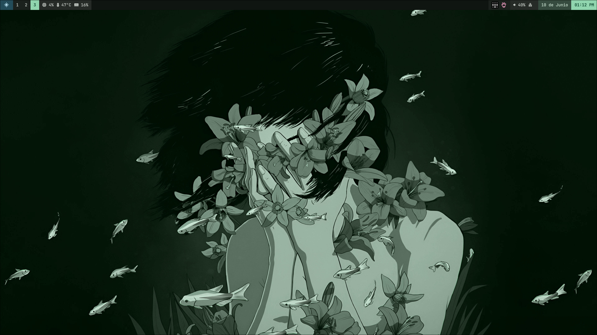
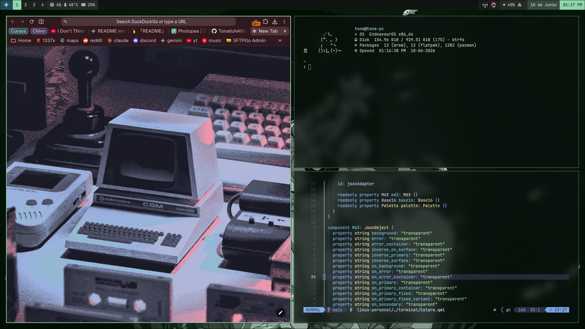
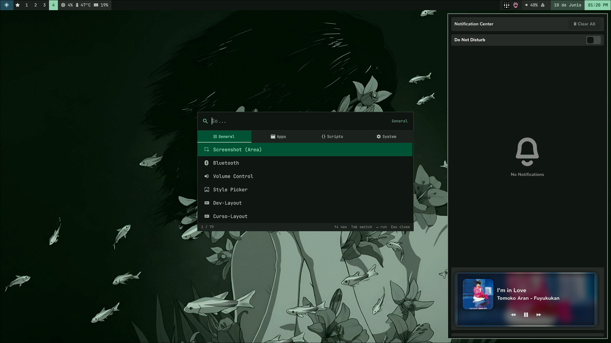
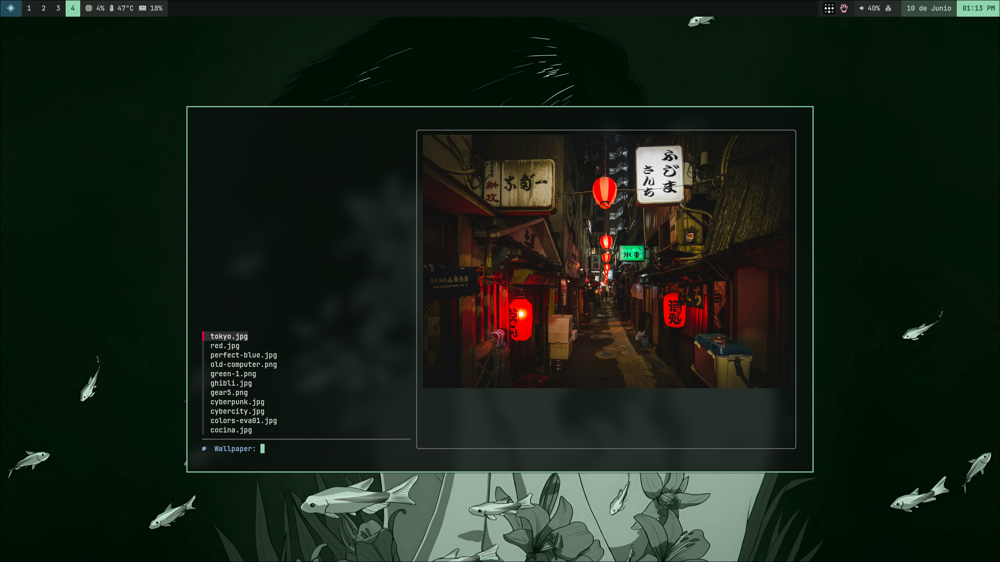

# 🐧 Tona's Dotfiles 

<div align="center">
  
  
  
</div>


# ✳️ Overview

```text
~/dotfiles -----------------------------------------------------------------------------------
» tona --version
tona-dotfiles v3.0.0 | "La simplicidad es la máxima sofisticación."

⚡ CORE SYSTEMS
├── OS                  :: Fedora 44
├── Window Manager      :: Hyprland
├── UI                  :: Quickshell
└── Shell               :: ZSH
  
💻 APPLICATIONS
├── Terminal            :: Kitty
├── Editor              :: Neovim
├── Multiplex           :: tmux
├── File Manager        :: Yazi
└── IA Agent            :: Claude Code
```

## 📸 Screenshots


| Desktop | Tiling Manager |
| --- | --- |
|   |   |
| **App Launcher & Notifications** | **Style Picker** |
|   |   |


# ⌨️ Usability

```text
~/dotfiles -----------------------------------------------------------------------------------
» man dotfiles

DOTFILES(1)                     Manual del Usuario                    DOTFILES(1)

NAME
       dotfiles - gestión de configuraciones vía GNU Stow

SYNOPSIS
       cd ~/dotfiles && stow [-t <destino>] <paquete> [paquete ...]

DESCRIPTION
       Cada carpeta de primer nivel del repo es un paquete de Stow
       independiente, con su propia ruta relativa a $HOME ya incluida adentro
       (hypr/.config/hypr/hyprland.lua -> ~/.config/hypr/hyprland.lua).
       Como el repo vive en ~/dotfiles, el destino por default de Stow (la
       carpeta padre) ya es ~, así que -t ~ es opcional. Instala, quita o prueba cada app por separado sin
       arrastrar las demás.

REQUIREMENTS
       stow   sudo pacman -S stow   /   sudo dnf install stow

OPTIONS
       -t, --target=DIR
              Carpeta destino donde se crean los symlinks (normalmente ~).

       -n, --no, --simulate
              No toca nada, solo imprime qué haría. Úsalo siempre antes de
              aplicar algo nuevo.

       -v, -vv, -vvv
              Verbosidad creciente: qué archivos enlaza o desenlaza.

       -S, --stow
              Instala (crea symlinks). Es el modo por default.

       -D, --delete
              Desinstala: borra los symlinks del paquete sin tocar el repo.

       -R, --restow
              Equivale a -D seguido de -S. Útil tras agregar o quitar
              archivos dentro de un paquete.

       --adopt
              PELIGROSO. Absorbe archivos ya existentes en $HOME hacia el
              repo, sobrescribiendo lo que ya tenías versionado. Revisa
              "git diff" de inmediato si lo usas.

EXAMPLES
       stow -nv -t ~ hypr
              Simula (no aplica nada) e imprime cada symlink que crearía.

       stow -t ~ hypr quickshell
              Instala varios paquetes de un jalón.

       stow -R -t ~ kitty
              Re-enlaza "kitty" después de editar qué archivos tiene el
              paquete.

       stow -D -t ~ waybar
              Quita los symlinks de "waybar" sin tocar el repo.

       for app in */; do stow -t ~ "${app%/}"; done
              Instala todo de un jalón. No es el flujo recomendado: el punto
              de tener paquetes por app es justo no instalar lo que no usas.

       .zshenv vive en la raíz del repo (no es un paquete) y se enlaza a mano:

              ln -s dotfiles/.zshenv ~/.zshenv

WARNINGS
       Estos archivos están estrictamente personalizados para mi hardware y
       flujo de trabajo. No ejecutes nada a ciegas: simula primero con -n,
       revisa qué haría, y adopta bajo tu propio riesgo.

DOTFILES(1)                                                            DOTFILES(1)
```

# 🎓 More of Me

```md
~/dotfiles -----------------------------------------------------------------------------------
» curl -s https://tonatiuham.dev

🧑‍💻 Tonatiuh
├── Role   :: DevOps & Linux SysAdmin Enthusiast
├── Stack  :: Python • Linux • TUI Workflow
└── Domain :: https://tonatiuham.dev
```

<div align="center">
  <span style="font-size: 1.1em;"><b><a href="https://tonatiuham.dev">tonatiuham.dev</a></b></span>
</div>
